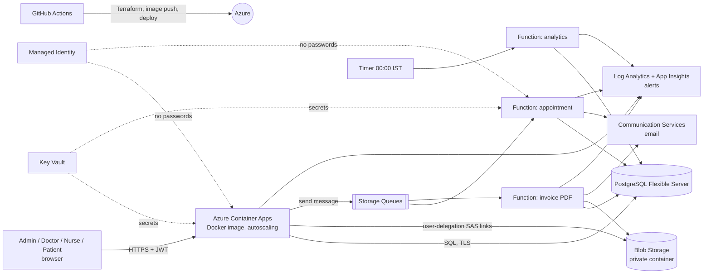

# MediSync: Secure, Cloud-Native Hospital Management System (Microsoft Azure)
**Cloud Computing & DevOps mini-project** · Team MediSync · CSE-C, 5th Sem · Supervisor: Ms. Devi Sivasankari P
Team: A V Rohith Varma (245805270) · K Bhavesh Reddy (245805190) · Jeevan Reddy (245805374)

The hospital app (patients, appointments, beds, records, billing) is intentionally modest. **The focus is the cloud architecture and the DevOps workflow around it.**

## Architecture


## Cloud and DevOps topics → where they are used (for the presentation)
| # | Topic | How we used it | Where |
|---|-------|----------------|-------|
| 1 | **Containers / Container Apps (PaaS)** | API runs as a Docker image on Azure Container Apps with HTTP autoscaling (1 to 3 replicas) and health probes | `infra/compute.tf`, `app/Dockerfile` |
| 2 | **Managed database (PaaS)** | Azure Database for PostgreSQL Flexible Server: automated backups, TLS enforced, encrypted at rest; unique index + conditional UPDATE stop double-booking | `infra/data.tf`, `app/db/schema.sql` |
| 3 | **Serverless / FaaS** | 3 Azure Functions: queue-triggered booking confirmation, queue-triggered PDF invoice, timer-triggered nightly analytics | `functions/src/functions/*` |
| 4 | **Event-driven architecture / messaging** | API drops a message in Azure Storage Queues; Functions react asynchronously, so the API stays fast during bursts | `app/src/cloud.js`, `infra/data.tf` |
| 5 | **Object storage** | Private Blob container, versioning, soft-delete, TLS 1.2; browser gets 10-minute user-delegation SAS links | `infra/data.tf`, `app/src/cloud.js` |
| 6 | **Notifications (managed email)** | Azure Communication Services email: appointment confirmations and invoice-ready mails | `functions/src/shared.js`, `infra/data.tf` |
| 7 | **Identity & access** | Managed Identity + Azure RBAC (AcrPull, Blob Data Contributor, Queue Sender): no stored credentials for Azure services. App-level login = bcrypt + JWT with 4 roles (RBAC) | `infra/core.tf`, `app/src/auth.js` |
| 8 | **Secrets management** | Key Vault holds DB password, JWT key, admin password, ACS key; apps read them via Key Vault references through the managed identity | `infra/core.tf`, `infra/compute.tf` |
| 9 | **Encryption / cloud security** | Encryption at rest (Postgres, Blob), TLS everywhere, least-privilege roles, private containers, audit trail of every sensitive action | `infra/*.tf`, `app/src/auth.js` |
| 10 | **Infrastructure as Code (Terraform)** | Entire environment is code; remote state in Azure Blob; one command to destroy | `infra/*.tf` |
| 11 | **CI/CD (GitHub Actions)** | test → validate Terraform → build image → push to ACR → `terraform apply` rolls out the new image → deploy Functions → smoke test | `.github/workflows/ci-cd.yml` |
| 12 | **Passwordless pipeline (OIDC federation)** | GitHub logs in to Azure with a federated managed identity: no secrets stored | `scripts/bootstrap.sh` |
| 13 | **Containerization** | Multi-stage, non-root image with HEALTHCHECK; docker-compose for local dev | `app/Dockerfile`, `docker-compose.yml` |
| 14 | **Monitoring & logging** | Log Analytics (container logs, JSON audit lines), Application Insights (Functions), metric alerts (API 5xx, DB CPU) with email action group | `infra/monitoring.tf` |
| 15 | **Autoscaling / elasticity** | Container Apps HTTP scale rule; Functions scale per queue length (consumption plan) | `infra/compute.tf` |
| 16 | **Cost management (FinOps)** | Azure for Students credit cap, smallest SKUs, consumption pricing, `destroy` workflow | `destroy.yml` |
| 17 | **Shift-left testing** | Jest tests run in CI before any deployment | `app/test` |

## Run locally (no Azure needed)
```
docker compose up --build
```
Open http://localhost:3000. Demo logins (shown as chips on the login page): Admin `admin@medisync.local / Admin@12345`, Doctor `dr.rao@medisync.local / Doctor@123`, Nurse `nurse@medisync.local / Nurse@123`, Patient `patient@medisync.local / Patient@123`.
Locally, files go to disk and events are handled inline, so every feature works (booking, upload, discharge → invoice).
Tests: `cd app && npm install && npm test`.

## Deploy to Azure (about 30 to 40 minutes, mostly waiting)
1. **GitHub:** create a *public* repo named `medisync` and upload everything from this folder (drag the files and folders onto "Add file → Upload files"; make sure `.github` is included).
2. **Azure Cloud Shell:** in https://portal.azure.com click the `>_` icon (top bar), choose **Bash**, accept creating the small storage it asks for.
3. In Cloud Shell:
   ```
   git clone https://github.com/<you>/medisync && cd medisync
   ./scripts/bootstrap.sh <you>/medisync
   ```
   It prints 5 values. If it fails with a region error, run `LOCATION=<allowed region> ./scripts/bootstrap.sh <you>/medisync`.
4. **GitHub secrets** (repo → Settings → Secrets and variables → Actions → New repository secret): `AZURE_CLIENT_ID`, `AZURE_TENANT_ID`, `AZURE_SUBSCRIPTION_ID`, `TF_STATE_RG`, `TF_STATE_SA` (all printed by the script) plus `ALERT_EMAIL` (your email) and `ADMIN_PASSWORD` (choose one).
5. **Run the pipeline:** repo → Actions → *ci-cd* → Run workflow. First run takes 15 to 25 minutes (Postgres and email domain are slow to create).
6. Open the finished run: the **App URL** appears in the run summary annotations and the smoke-test step. Sign in as `admin@medisync.local` with your `ADMIN_PASSWORD`; demo doctor/nurse/patient accounts are pre-created (`seed_demo = true`).
7. **After the demo:** Actions → *destroy-environment* → type `DESTROY`.

### Troubleshooting (Azure for Students quirks)
| Error | Fix |
|---|---|
| "RequestDisallowedByAzure" / region not allowed | Set `TF_VAR_location` (or edit `location` default in `infra/variables.tf`) to a region from the error message |
| Postgres "location is restricted" | Set `db_location` to another allowed region |
| Function app: "Dynamic VMs quota is 0" | Set `function_sku = "B1"` (variables.tf) |
| Container App can't pull image / secrets not ready | Re-run the workflow (role assignments need a minute to propagate) |
| Email domain / ACS errors | Re-run once; email is optional, the app works without it (check `NOTIFY_EMAILS`) |

## Known limitations (be upfront with ma'am)
- **Identity:** Microsoft Entra ID isn't used for end-user login because the college tenant doesn't let students register apps; users are stored in PostgreSQL (bcrypt) and sessions use signed JWTs. Azure RBAC and Managed Identity still secure all Azure resource access.
- Database uses a public endpoint restricted to Azure services (TLS enforced). Production would use VNet integration and private endpoints.
- The pipeline's identity has Owner on the subscription (it creates role assignments); production would use a scoped custom role.
- Email uses the Azure-managed sender domain (may land in spam); SMS is not included.
- Demo accounts with known passwords are seeded for presentation; set `seed_demo = false` for any real use.
- Terraform, the pipeline and the Azure code paths were written without access to a live Azure subscription, so expect to fix a small error or two on the first deploy.
